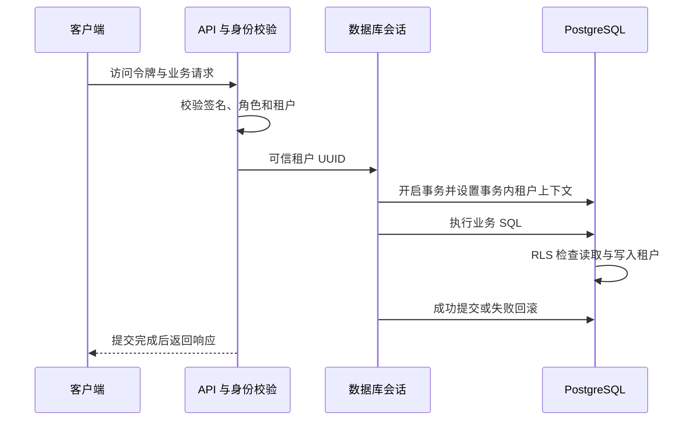

# 后端基础能力与服务模板

记录日期：2026-10-20。负责人：JIANG YIBAI。对应一期 B1 和 proposal WBS 3.1。

本轮实现共享包和可运行的服务模板，业务服务按后续步骤逐个落地。业务设计由当前后端工作流确定；需要队友采用的约定记录在[协作对齐清单](team-alignment.md)，无需等待人工逐项确认后才开始实现。当前分支上的改动由 Jiang 手动复查和提交。

## 1. 交付边界

| 能力 | 本轮交付 |
| --- | --- |
| 共享包 | `libs/` 下的 `lostlink-common`，可由 pip 安装 |
| 配置 | 环境变量与 `.env`；数据库凭据使用敏感字段；部署环境检查必填项 |
| 身份认证 | Cognito RS256 访问令牌、JWKS、签发方、有效期、应用客户端白名单 |
| 授权 | 角色、OAuth scope、租户上下文的 FastAPI 依赖 |
| 数据库 | SQLAlchemy 同步会话、事务、连接池、租户上下文和 RLS 迁移辅助函数 |
| 事件 | 五种首批事件的版本一载荷、统一信封、SNS/SQS 发布及消息解析 |
| 可观测性 | JSON 应用日志、请求关联 ID、HTTP 请求数和延迟指标 |
| 模板 | 应用工厂、依赖生命周期、统一错误、探针、受保护示例接口和迁移 |
| 验证 | 签名令牌测试、真实 PostgreSQL 隔离测试、LocalStack 消息测试、CI 接入 |

尚未实现业务服务、事务发件箱、消息消费循环、邮件发送、合作方 webhook 或跨场馆搜索读模型。共享发布器不宣称解决数据库与消息系统之间的原子提交。

## 2. 配置与部署

- `ENVIRONMENT` 支持 `local`、`test`、`dev`、`prod`。
- `dev`、`prod` 必须提供数据库连接、Cognito 签发方和客户端白名单；不允许覆盖 AWS 服务地址。
- `local`、`test` 可以连接 LocalStack；只有显式配置模拟端点时才使用模拟凭据。
- 云环境通过 AWS SDK 默认凭据链使用工作负载身份；不在代码中存放真实密钥。
- `DATABASE_URL` 只供运行时使用；`MIGRATION_DATABASE_URL` 只供迁移作业使用。
- `.env.example` 只含本地开发配置；`.env` 不进入版本控制。
- 运行时、测试依赖分别锁定在仓库根目录的两个锁文件中，Windows/Linux 共用。
- Docker 构建上下文改为仓库根目录，以便安装共享包；服务路径通过 `SERVICE_DIR` 参数选择。
- 模板暂采用同步 SQLAlchemy 与同步 AWS SDK；FastAPI 同步依赖和处理函数在线程池中运行，避免把阻塞调用放进异步处理函数。

## 3. 身份与授权

所有业务 API 接受 `Authorization: Bearer <access_token>`。

校验顺序为：限制令牌长度，限制算法为 RS256 并要求 `kid`，通过配置的 JWKS 地址取得公钥，校验签名、`iss`、`exp`、`iat`，要求 `token_use=access`，校验 `client_id` 位于白名单。配置资源受众时另外校验 `aud`。不会使用令牌中提供的地址下载公钥。

JWKS 集合有缓存，具体公钥不使用永久缓存；底层库支持未知密钥刷新和轮换。网络读取有超时。无法取得 JWKS 时返回 503；无效令牌返回 401。

| 身份字段 | 来源与规则 |
| --- | --- |
| `subject` | 已验证的 `sub`；兼容用户和机器客户端，不强制它为 UUID |
| `client_id` | 已验证的应用客户端 ID |
| `roles` | `cognito:groups` |
| `scopes` | `scope`，按空格拆分 |
| `tenant_id` | 默认取 `custom:tenant_id`，存在时必须为 UUID |

`require_roles` 要求命中任意一个允许角色；`require_scopes` 要求具备全部指定 scope；`require_tenant` 在缺少场馆身份时返回 403。没有租户的失主或合作方仍可通过身份认证，但不能使用场馆数据会话。

员工角色采用 `venue_admin`、`venue_staff`，失主采用 `owner`。合作方使用 scope 授权。多场馆员工在首期每次令牌只对应一个活动场馆，切换场馆必须经可信服务重新签发，不能通过请求头切换。

**Cognito 配置依赖：**普通自定义用户属性不能被假定为已经存在于访问令牌中。云端须通过访问令牌定制机制，将服务端可信的场馆成员关系注入 `custom:tenant_id`。该属性不得允许普通用户自行填写或修改。缺少 claim 时拒绝场馆操作，不回退到 ID token 或 `X-Tenant-ID`。

依据：[AWS 访问令牌说明](https://docs.aws.amazon.com/cognito/latest/developerguide/amazon-cognito-user-pools-using-the-access-token.html)、[访问令牌定制触发器](https://docs.aws.amazon.com/cognito/latest/developerguide/user-pool-lambda-pre-token-generation.html)、[PyJWT 校验接口](https://pyjwt.readthedocs.io/en/stable/api.html)。

## 4. 数据隔离与事务

每个服务拥有独立数据库 schema、模型和迁移历史。共享包只提供通用列与会话能力，不引入跨服务 ORM 模型。

场馆数据表必须包含非空 UUID 类型 `tenant_id`。迁移同时启用 `ENABLE ROW LEVEL SECURITY` 和 `FORCE ROW LEVEL SECURITY`，策略同时设置读取过滤与写入检查。缺少租户上下文时读取为空、写入被拒绝。

每个事务通过 `set_config(..., true)` 设置租户，不在池化连接上使用持久 `SET`。事务结束后该上下文失效，下一个租户复用连接时重新设置。会话入口拒绝缺少租户的调用。

运行时数据库角色不得拥有超级用户或 `BYPASSRLS` 能力；会话及就绪检查会验证这一点。迁移角色拥有建表权限，运行时角色仅有 schema 使用权、业务表增删改查及迁移版本读取权限。模板不授予建表、修改迁移版本或清空表的权限。

模板使用 `scope="function"` 的会话依赖，保证数据库提交在发送 HTTP 响应前完成。业务代码可以 `flush`，但应由会话上下文统一提交和回滚。

跨场馆搜索不能通过关闭 RLS 实现。后续 matching 服务维护只含公开物品信息的检索读模型；隐藏核验细节、联系方式和内部审计信息保留在受限制的业务数据中。

依据：[PostgreSQL 行级安全机制](https://www.postgresql.org/docs/16/ddl-rowsecurity.html)。

## 5. 事件契约

共享信封包含 `event_id`、`event_type`、`schema_version`、`source`、`occurred_at`、可选 `tenant_id`、`correlation_id` 和 `data`。ID 为 UUID，时间必须带时区，当前版本为 1。拒绝未知事件、错误发布方、缺少必要字段和多余载荷字段。

| 事件 | 发布服务 | 版本一载荷 |
| --- | --- | --- |
| `item.registered` | `item-service` | `item_id`、`item_version`、`photo_bucket`、`photo_key`、`description`、`category`、`found_at` |
| `item.embedded` | `embedding-worker` | `item_id`、`item_version`、`model_version`、`dimensions=512` |
| `lost_report.created` | `matching-service` | `report_id`、`owner_id` |
| `match.found` | `matching-service` | `match_id`、`report_id`、`item_id`、`owner_id`、`score` |
| `claim.approved` | `claim-service` | `claim_id`、`item_id`、`owner_id` |

除失物报告事件外都要求场馆租户。`item_version` 从 1 开始，用于避免旧照片或旧描述的异步结果覆盖新版本。`score` 定义为余弦相似度，取值范围为 -1 到 1；它不是匹配概率。事件不包含隐藏核验答案、联系方式、完整图片或带凭据的预签名 URL。

`item.registered` 在物品元数据保存、照片上传确认后才发布；仅生成上传 URL 不代表登记链路已经完成。事件载荷中的描述与分类是供检索使用的公开信息。

SNS/SQS 发布器用于标准主题和标准队列，包含有界超时和 SDK 重试；暂不支持 FIFO。SNS 消息属性包含事件类型和版本，便于订阅过滤。解析器兼容原始消息和 SNS 包装消息。载荷限制为 240 KiB。

这些传输为至少一次语义。同一逻辑事件重试复用相同 `event_id`，消费者以该 ID 去重；确认业务处理提交后才删除 SQS 消息。业务服务阶段实现事务发件箱与消费去重表；禁止把“数据库写入成功后直接 publish”当作可靠的最终流程。

`decode_message` 只负责解析及契约校验，不验证 SNS HTTP 签名。它只应接收已经通过 IAM/队列策略限制来源的 SQS 消息，不应用作公网 webhook 接收器。

## 6. 探针、日志和错误

- `/health` 只说明进程存活。
- `/ready` 要求身份校验器已配置，数据库可访问，运行时角色安全，迁移版本匹配；缺少配置返回 503。身份检查不在每次探针请求时访问 Cognito。
- 当前模板不强制配置 SNS/SQS，后续需要队列的服务须添加对应依赖检查。
- `/metrics` 提供 HTTP 请求次数和延迟直方图，仅供内部采集，不经过公网入口开放。
- HTTP 指标使用路由模板，不使用物品 ID、查询参数、用户或租户作为指标标签；未知路径合并为统一值。
- 请求 ID 接受合法 UUID，否则重新生成；响应头与错误体返回同一个 ID。
- HTTP 日志不记录请求体、查询字符串、令牌、联系方式或原始异常内容；异常日志只写异常类型。业务代码也不得把敏感值主动拼接到日志消息。
- 启动 Uvicorn 时关闭其默认访问日志，使用共享中间件提供的访问日志。
- 错误体格式为 `error.code`、`error.message`、可选 `error.details` 和 `request_id`；请求校验错误仅返回字段位置和错误类型。

## 7. 验证与使用

操作命令见[模板说明](../services/service-template/README.md)和[共享包说明](../libs/README.md)。

集成测试创建随机命名数据库和受限角色，验证迁移重复执行、回滚与重建，跨租户查询、更新、删除和写入阻断，无上下文访问拒绝，事务回滚及连接池复用。测试结束清理它自己创建的资源，不迁移原有业务数据库。

事件测试在 LocalStack 创建临时主题与队列，验证 SNS→SQS 和直接 SQS 投递，再清理对应资源。Cognito 单元测试使用测试进程内生成的 RSA 密钥及 JWKS；真实云端身份配置和 SES 联调留待部署阶段。

### 本轮验证记录

2026-10-20 在当前 Windows 开发环境完成：

- 完整测试 71 项通过，其中单元测试 61 项、真实依赖集成测试 10 项，无跳过项。
- Ruff 静态与格式检查通过，Git 补丁空白检查通过。
- 从仓库根目录构建 Linux 镜像成功，容器内依赖一致性检查通过。
- 本地开发库已建立受限 `lostlink_app` 角色与 `service_template` 示例 schema；没有建立业务服务的数据表。
- 新版验证容器为 `lostlink-phase1-template`，监听 `http://127.0.0.1:8001`；原先 8000 端口的旧模板未替换。
- 实测 `/health`、`/docs`、`/openapi.json`、`/metrics` 返回 200；未认证的 `/v1/me` 返回 401。
- `/ready` 返回 503，明确显示数据库就绪、身份未配置。这是缺少真实 Cognito 设置时的预期结果。
- GitHub Actions 的配置已更新，远端运行和 AWS 联调尚未执行；本轮未创建 commit。
