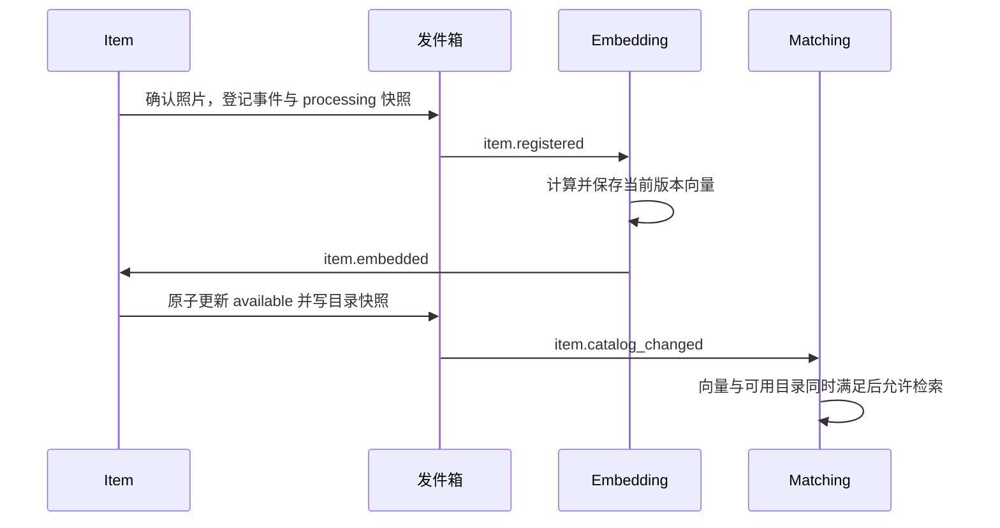

# 可靠消息、任务租约与事件扩展

状态：待实施设计。任务：T0 提供工具，各服务在自己的 schema 建表。参考[统一契约](01-contracts-and-access.md)。

## 1. 需要解决的失败窗口

数据库写入和 SNS/SQS publish 不能组成同一个本地事务。业务处理只在事务内写发件箱，后台再投递。投递成功但确认落库失败时仍可能重投，因此采用至少一次投递及消费幂等，不宣称严格一次处理。

不在 API 事务内同步等待消息系统，不启动无持久状态的内存后台线程承担业务投递。API、发件箱投递器、消息消费者、通知发送器可共用镜像，但作为独立进程启动。

## 2. 表与权限

| 表 | 核心字段与约束 |
| --- | --- |
| `outbox_events` | `event_id` 主键、`aggregate_type`、`aggregate_id`、`aggregate_version`、完整信封 JSON、`destination`、`status`、`attempts`、`available_at`、`lease_token`、`lease_until`、`sent_at`、`last_error_code` |
| `inbox_receipts` | `(consumer_name,event_id)` 联合主键、`payload_hash`、`processed_at`、`result_code` |
| `idempotency_records` | 调用者/操作/key 唯一键、请求摘要、资源/操作 ID、结果、到期时间 |
| `audit_entries` | ID、主体类型及 ID、tenant/owner、资源、动作、结果、request ID、时间；不保存原始请求或秘密 |

发件箱索引为 `(status,available_at)`；租约索引为 `(status,lease_until)`。每个服务的工作者只能访问本 schema。API 不应具有更新投递状态或删除审计记录的权限；工作者可认领发件箱，不因此获得领域表的全租户查询权。

这些 operational 表不直接使用 `TenantRecord`。需要租户的领域变更通过可信事件上下文另开受限事务。用户可查询的异步任务表则包含 owner/tenant 及对应 RLS，不得把 outbox 原表当作公开操作列表。

## 3. 发件箱算法

1. 业务事务生成固定 `event_id`，保存领域变更及完整信封；目的地只能来自服务配置的允许列表。
2. 投递器在短事务内按可用时间选取最多 50 条，通过 `FOR UPDATE SKIP LOCKED` 避免多个实例认领同一行；生成新的 `lease_token`，设置 60 秒租约并提交。
3. 在事务外发布消息。成功后仅当租约 token 仍匹配时标记 `sent`。
4. 失败时更新错误码及下次时间；采用指数退避与随机扰动，初始 1 秒，上限 5 分钟，最多 10 次主动尝试，之后标为 `failed`，由受保护的运营重放流程处理。
5. 进程崩溃后，其他工作者可重新认领过期租约。旧工作者的迟到结果不能覆盖新租约。

轮询空闲时等待约 1 秒，停机时停止认领并尽量完成当前任务；租约是最终恢复手段。手动重放保留原事件 ID、载荷和业务版本，另记审计，不生成新的逻辑事件。

成功项保留至少 30 天，清理批量执行。失败项不自动删除。禁止在事务重试时重新生成事件 ID，禁止把请求 key 直接当成所有事件的 ID。

## 4. 消费算法

1. SQS 长轮询；校验大小、信封、版本、注册类型、发布源与此队列允许消费的事件集合。
2. 在领域处理事务内插入 inbox 唯一键。已存在相同摘要且已完成则作为重复确认；同 ID 不同载荷视为协议错误并告警。
3. 在同一事务内更新领域数据、审计及必要的新 outbox 事件，最后提交 inbox 记录。
4. 事务提交后删除 SQS 消息；删除失败允许重投，由 inbox 去重。
5. 外部邮件、Webhook、Cognito 或跨服务写操作只能在这里创建持久工作任务，不能在 inbox 事务内直接执行。

初始可见性超时 60 秒；长任务周期续租，但必须有最大执行时间。异常时不提前删除消息。无效载荷、未知版本和反复失败消息通过 redrive 策略进入 DLQ，默认最大接收次数 5；记录错误码、事件 ID、队列与 consumer，不记录私人载荷。

inbox 保存期默认 30 天，必须覆盖源队列、DLQ 及允许人工重放的总窗口。超出窗口重放只能经审计操作，并重新评估业务唯一约束，不能保证仅靠已清理的 inbox 去重。

## 5. 乱序与领域版本

普通 SNS/SQS 不要求全局顺序。消费者依靠领域版本判断：

- `item_version` 表示会影响 embedding 的内容版本。
- `revision` 表示物品行状态/公开快照版本；预留、交接、撤销也会递增。
- 检索读模型仅接受大于自身 `revision` 的完整目录快照，旧快照忽略但消息正常确认。
- `item.embedded` 只能作用于相同 `item_version` 的处理中物品；撤销、预留和已交接物品不会被旧事件重新变为可用。
- 业务同义重复（不同 event ID 表示同一 match）还需要领域唯一键，不能只依赖 inbox。

同一内容版本的人工重新处理需要隔离不同处理轮次。Item 为每次新处理生成 UUID，保存为 `processing_correlation_id`，同时填入登记事件现有的 `correlation_id`；工作者的成功/失败结果必须原样传递该值。同一轮的传输重投保持 event ID 和 correlation ID，显式重试则生成新的二者。Item 仅接受租户、`item_version`、处理 correlation ID 均匹配且状态为 processing 的结果，防止上一轮迟到失败终止新一轮处理。原 HTTP request ID 单独写审计，不替代处理轮次标识。该约定不增加旧载荷字段，但需要同步更新工作者契约测试。

## 6. 保留与新增事件

现有五种版本一事件保持字段、发布方及含义，见 `libs/src/lostlink_common/event_schemas.py`。尤其不能直接给 `item.registered` 增加字段，因为现有载荷禁止 extra。

以下扩展事件均使用 `schema_version=1`，不修改旧事件版本。UC1 已注册并验证 `venue.membership_changed`；其余事件需后续任务先注册并加入契约测试，之后生产者才能发送。

| 新事件 | 发布服务 | `data` 必需字段 |
| --- | --- | --- |
| `item.catalog_changed` | `item-service` | `item_id`、`item_version`、`revision`、`state`、`title`、`description`、`category`、`found_at`、`venue_id`、可空 `photo_bucket`、可空 `photo_key` |
| `item.embedding_failed` | `embedding-worker` | `item_id`、`item_version`、`error_code` |
| `claim.handed_over` | `claim-service` | `claim_id`、`item_id`、`owner_id`、`mode`（`counter`/`courier`）、`handed_over_at` |
| `claim.cancelled` | `claim-service` | `claim_id`、`item_id`、`owner_id`、`reason_code` |
| `venue.membership_changed` | `venue-service` | `membership_id`、`user_sub`、`version`、`status` |

上述事件都要求信封 `tenant_id`。`item.catalog_changed` 是完整的公开目录状态快照，只有 `state=available` 时可以在搜索结果中展示；其他状态应保留版本墓碑而非直接遗忘版本，防止旧事件重新加入索引。

`item.embedding_failed` 的错误码限定 `invalid_image`、`model_failure`、`retry_exhausted`，不携带堆栈或对象内容。瞬时失败先重试，不立即发布终态失败。`claim.cancelled` 的原因使用受控枚举，不包含用户自由文本。

物品处理时序：

匹配服务同时接收目录快照和 embedding 完成信号，两者顺序任意；缺少任一数据时继续保留待完成状态。后台定期重试未完成的关联，不通过读取其他服务业务表补洞。

事件迁移采用“先发布可识别新类型的消费者/共享包，再启用生产者”。旧消费者遇到未支持的版本不能悄悄丢弃；队列订阅过滤应把不同消费职责分开。

## 7. 对外扩展边界

合作方 Webhook 不是直接转发内部 DomainEvent。Notification 根据交付授权生成独立的对外事件信封及字段白名单；`owner_id`、内部租户和核验资料不会默认暴露，见[合作方设计](07-partner-api-and-webhooks.md)。

## 8. T0 验收

- 数据库事务回滚时无领域变更、无 outbox；消息不可用时 API 仍可提交异步任务。
- 两个投递实例同时工作不会覆盖彼此租约；发布成功后进程崩溃可恢复且消费结果不重复。
- 同事件 ID/不同载荷被拒绝；重复语义 match 不重复创建通知。
- 崩溃、超时、可见性续租、DLQ 和人工重放都有可观察状态。
- 旧物品版本和乱序目录快照不能恢复已撤销/已交接物品。
- 不同服务数据库角色互不可读；普通 API 不能修改投递确认或删除审计。
