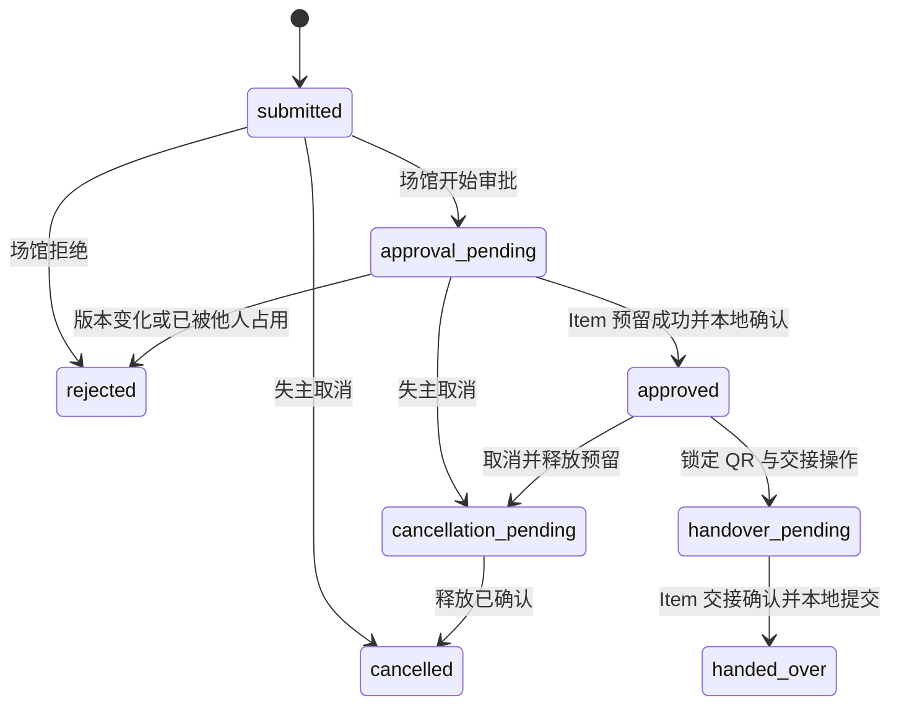

# Claim Service 设计与实施任务

接入进度：UC2 已提供真实 Item 预留、查询、释放墓碑及交接提交接口，可据 [UC2 运行说明](../../services/item-service/README.md)开展联调。Claim 本任务仍待实施，不能把 Item 的接口测试视为 UC5 已完成。

共享前置（2026-10-20 已实现，见 [01 第 8 节](01-contracts-and-access.md)）：失主请求用 `actor_session(principal, venue_scope=False)` 或 `get_owner_session`，员工请求用 `venue_scope=True` 并另行调用 `MembershipClient.require_current`；主表可用 `enable_owner_or_tenant_rls`，联系方式表自写策略；联系人快照与 QR 重放值用 `FieldCipher` 加密，AAD 绑定 `claim-service`、表、列和记录 ID；已验证邮箱用 `IdentityDirectory.resolve_verified_email`；`claim.handed_over`、`claim.cancelled` 已注册可直接写入 outbox。

任务：T3。目录：`services/claim-service/`。覆盖 UC5，并提供 Seed 2 的用户授权基础。依赖：[统一契约](01-contracts-and-access.md)、[可靠消息](02-reliable-messaging.md)、[Item 内部接口](04-item-service.md)。

## 1. 数据模型与隐私

| 表 | 核心字段与约束 |
| --- | --- |
| `claims` | `id,tenant_id,item_id,item_version,owner_sub,state,version,created_at,approved_at,reviewed_by` |
| `claim_answers` | `claim_id,question_id,question_version,prompt_snapshot,answer_text`；归属 claim，不保存标准答案 |
| `claim_contacts` | `claim_id,owner_sub,encrypted_contact,key_id`；联系人和已验证邮箱快照 |
| `claim_operations` | `id,claim_id,kind,state,step,expected_claim_version,attempts,available_at,lease_token,lease_until,last_error_code` |
| `handover_tokens` | `id,claim_id,token_hash,expires_at,state,encrypted_replay_value,replay_expires_at,handover_id` |
| `handover_records` | `handover_id` 唯一、`claim_id` 唯一、`mode,operator_sub,state,completed_at` |
| 公共表 | outbox、inbox、幂等、审计；交付授权表见 07 |

对同一 `(owner_sub,item_id)` 处于非终态的认领建部分唯一约束。每个 claim 最多一个活跃协调操作、一个有效 QR、一次交接记录。各表使用租户或 owner 访问策略，不调用现有 `session(None)`。

失主可查看自己的认领与联系方式；员工只可查看本场馆认领。员工查看联系方式还要求 claim 为 approved/handover_pending/handed_over 且与该次交接有关。核验问答与联系人使用独立 DTO，列表不返回邮箱、电话或 QR。

认领失败/拒绝/取消后不继续披露联系人。已交接记录只按明确审计权限访问，普通场馆列表不永久暴露联系人；默认交接后 30 天清理联系快照，保留脱敏业务与审计字段。

## 2. 创建认领

请求只包含 `item_id`、回答列表及可选联系人姓名/电话；`owner_sub` 来自身份，`tenant_id`、题目版本、物品版本来自 Item 的 claim-context。

创建前 Item 必须为 available。验证题目 ID、题目版本和回答数量，不能由客户端自行增加问题或跳过必答项。服务保存题目快照以供人工核验，但不给失主返回参考答案或匹配评分。

邮箱由身份目录读取已验证的用户邮箱；未验证时返回可处理错误，不向任意输入地址发信。本人声明的电话用于获批后的联系，不作为身份核验凭据。首期采用人工核验，不引入自动答案评分或以相似度直接批准。

## 3. 外部 API

| 方法与路径 | 身份 | 请求/结果 |
| --- | --- | --- |
| `GET /v1/claim-questions?item_id=...` | owner | 经 Item 代理返回问题和版本，不返回参考答案 |
| `POST /v1/claims` | owner | `item_id,answers[{question_id,version,answer}],contact?`；201 |
| `GET /v1/claims` | owner | 仅本人的认领列表 |
| `GET /v1/claims/{id}` | owner | 本人详情、状态、操作引用 |
| `GET /v1/venue/claims` | staff/admin | 本场馆审核列表 |
| `GET /v1/venue/claims/{id}` | staff/admin | 问答及许可的审核信息 |
| `POST /v1/venue/claims/{id}/approve` | staff/admin | `If-Match`；202，审批操作 ID |
| `POST /v1/venue/claims/{id}/reject` | staff/admin | `reason_code,If-Match`；200 |
| `POST /v1/claims/{id}/cancel` | owner | `reason_code,If-Match`；同步完成 200 或需要释放 202。`reason_code` 取值同 `claim.cancelled` 事件枚举：`found_elsewhere/no_longer_needed/submitted_in_error/other` |
| `GET /v1/claim-operations/{operation_id}` | 本人或所属场馆员工 | 阶段、状态、可重试错误码；不暴露内部凭据 |
| `POST /v1/claims/{id}/handover-token` | owner | 已批准且无活动快递授权时签发 QR，201 |
| `POST /v1/venue/claims/{id}/handover` | staff/admin | `token,If-Match`；202，交接操作 ID |
| `GET /v1/venue/claims/{id}/contact` | staff/admin | 仅已批准且仍需交接时返回最小联系人 DTO |

上述动作 POST 都要求幂等 key。审核者不能是该认领的 owner，即使同一用户同时持有员工角色。

## 4. 完整状态机

瞬时依赖失败保留 pending 状态，不虚构 approved 或 cancelled。操作表记录重试阶段及错误。pending 超过 5 分钟告警；15 分钟主动重试预算耗尽后操作标为 `needs_attention`，业务状态保留，允许带审计的恢复，不自动丢弃预留。

协调器每次执行动作前检查 claim 当前状态和操作租约。拒绝只允许 submitted；handover_pending/handed_over 不允许取消。相同资源同时审批、取消或交接通过行锁、版本和唯一活动操作约束串行决定。

## 5. 审批协调流程

1. 员工请求在本地短事务验证权限、版本和状态，写 `approval_pending` 及审批操作，返回 202。
2. 工作者调用 Item reserve，携带固定 claim ID、认领时的物品版本及稳定幂等 key。
3. 若成功，本地事务再次检查操作仍是有效审批，再改为 approved，写 `claim.approved` outbox 和审计。
4. 若物品被占用/内容版本改变，认领终结为 rejected，原因使用明确业务码，不能把网络错误当作拒绝。
5. 若网络超时，查询 Item reservation 状态再决定重试；不能假设请求未执行。
6. 若失主在远端预留期间取消，本地批准条件失败，协调器执行 release；Item 的 release 墓碑阻止迟到 reserve 再占用。

业务表锁不跨 HTTP 调用持有。Item 预留成功、Claim 崩溃时，重启协调器会查询并完成批准或释放。`claim.approved` 只在本地批准提交一次时产生，不在每次网络重试产生新事件。

## 6. QR 与交接协调

批准后由 owner 主动签发 QR，不在 `claim.approved` 事件中携带码值。使用至少 32 字节安全随机数，QR 内容仅包含版本、claim ID、token ID 和随机值，不含联系人信息。

数据库长期只保存带服务器密钥的摘要或等效安全校验表示，默认有效期 24 小时。为了支持网络超时后的同 key 重放，单独加密保存原码最多 10 分钟且不超过 token 有效期；超过重放窗口返回 409，owner 可显式重新签发并原子作废旧 token。不能把原码放入普通明文幂等结果。

扫码时先验证当前员工资格、所属场馆、claim 状态、码有效期和摘要。一个事务把 token 从 active 变为 processing，分配固定 `handover_id`，claim 进入 handover_pending 并提交操作。另一请求无法使用同 token 启动第二次交接。

协调器调用 Item commit-handover：

- 成功或确认同一 handover ID 已 committed：本地标 token used、claim handed_over、交接完成，并写 `claim.handed_over`。
- 超时：保持 processing，查询远端 reservation；重试相同 handover ID。
- 明确尚未交接的可恢复失败：保留操作待重试；不得直接向用户展示已交接。
- 发现远端与本地矛盾：标记 needs_attention，禁止重新开放物品或重新激活旧码。

同 key 的重放可返回原交接操作；不同 key 重复扫码返回状态冲突。接口返回 handed_over 后，现场员工才将物品交给失主；202 处理中不能视为完成。QR 在成功锁定进入 processing 后，后续恢复不因码自然过期而丢弃已受理交接。

## 7. 取消

submitted 的取消在本地完成。approval_pending/approved 的取消先作废尚未使用的 QR、进入 cancellation_pending，再调用 Item release；只有释放确认后转 cancelled 并发布 `claim.cancelled`。

释放不成功时不把物品标为可用。已经受理的交接优先保持原操作，取消请求返回冲突。取消与快递授权的互斥和撤销要求见 07。

## 8. T3 验收与移交

- 无租户的 owner 能认领其他场馆物品，但只能查看自己的记录。
- 审批前员工无法通过任何详情/列表/联系接口取得邮箱或电话；参考答案始终不返回 owner。
- 两个 owner 同时申请同一物品，仅一个 claim 能批准并有效交接。
- 在远端预留成功后、本地提交前杀进程，可恢复且不遗留永久未处理预留。
- 审批与取消竞态、迟到 reserve/release、不同 handover ID 冲突都有真实集成测试。
- QR 超时、错误场馆、重复扫码、并发扫码、HTTP 响应丢失和处理中码过期均有确定结果。
- 提供状态迁移、操作恢复入口、Item 契约替身及真实联调脚本；未完成真实 Item 联调时明确标记。
