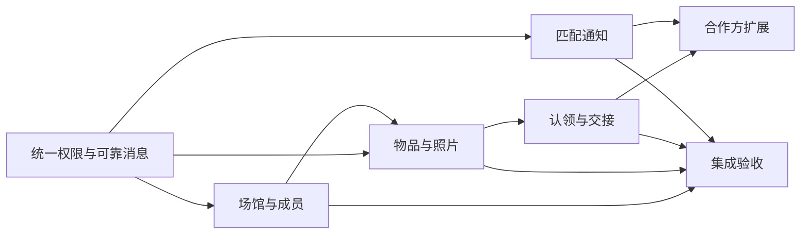

# 集成实施、验收与最终交接

任务：T6；各服务实施 Agent 也应据此准备测试和交付。

UC3 本地验收补充：Matching/Embedding 已有真实 CLIP、pgvector、实际 Item API 和 LocalStack 消息测试；运行配置与证据见 [UC3 记录](../uc3-implementation.md)。下表中的原责任人仍为团队分工，不能再将 Matching 视为仅有固定数据替身，也不能据此认为 Cognito、真实 AWS、SES 或 5,000 张照片吞吐已验收。

UC5 本地验收补充：第 4 节演示步骤 4—6 及第 8 步的“重启后恢复、无双重审批”已有 Claim 集成测试对应（真实 Venue/Item/PostgreSQL，进程内调用），见 [UC5 记录](../uc5-implementation.md)。步骤 7 依赖尚未实现的 Notification。

## 1. 开发顺序与外部依赖

| 依赖 | 对接责任 | 本地替身边界 | 真实验收条件 |
| --- | --- | --- | --- |
| Cognito | 云端负责人 + T1 | 测试生成 RSA/JWKS 和主体；只在测试注入 | 真正 access token、可信租户 claim、停用成员旧 token 拒绝 |
| S3/SNS/SQS | 云端负责人 + T0/T2 | LocalStack | 实际 IAM、订阅策略、对象权限、DLQ |
| Embedding | Yang Dongwei | 模拟消费登记并产生成功/失败事件 | 真正 CLIP 计算、版本保护及队列恢复 |
| Matching | Yang Dongwei | 固定测试数据和内部接口替身 | 向量与公开快照结合，失物报告和匹配通知上下文 |
| SES | 云端负责人 + T4 | 捕获发送器，无真实外发 | 已验证身份和明确授权的测试收件人 |
| Delivery | Yang Dongwei + T5 | 模拟订单/运输状态 | 平台授权、取件确认、配送状态及复用证据 |
| 前端 | Zhang Ji | Swagger 或最小演示页面 | access token、上传确认、异步状态及权限错误展示 |

替身必须通过与服务一致的请求/响应模型，不提供生产可用的认证绕过开关。缺少队友接口时可继续开发，但最终结果明确标识“契约测试通过，真实联调未完成”。

## 2. 服务骨架与迁移

每个新服务包含独立 Python 包、配置、路由、模型、领域处理、外部适配、worker 入口、迁移和测试。可以采用 `api/`、`domain/`、`adapters/`、`workers/` 分层，不把所有逻辑集中在 `main.py`，也不为简单 CRUD 引入无用抽象。

复制模板后移除示例表/接口，替换 schema、迁移版本和启动模块；保留探针、错误格式及日志。每个服务须能独立运行 pytest，并在根测试入口被正确收集。已迁移的模板 schema 不作为业务库复用。

迁移包含索引、唯一约束、RLS、角色授权和版本一致性。自动生成迁移必须限制在本 schema，人工审核 SQL；生产中已执行的迁移不能直接改写，采用追加迁移。API/worker 启动不自动运行迁移。

新增依赖先更新声明，再统一重建运行时与测试锁文件；不要只在某台开发机临时安装包。CI 对所有新服务测试、构建，并运行跨服务集成场景。保持安全扫描为构建前置。

## 3. 必须覆盖的测试矩阵

| 类别 | 必须证明的行为 |
| --- | --- |
| 身份 | 伪签名、过期、ID token、错误客户端、scope 缺失被拒绝；M2M 不能冒充 owner |
| RLS | 两个场馆互不可读写，owner 只能看本人，后台角色不能读其他服务 |
| 当前权限 | 成员停用、场馆停用后旧 JWT 不能继续敏感写入；权限服务故障不放行 |
| 幂等 | 同 key 同请求重放，同 key 不同请求冲突，响应丢失不重复创建动作 |
| 并发 | 最后管理员、物品预留、审批与取消、QR 消费、配送授权竞争结果唯一 |
| 可靠消息 | outbox 回滚、认领租约失效、发送后崩溃、重复/乱序、DLQ、人工恢复 |
| 外部副作用 | S3 照片封存与确认、邮件未知结果、Webhook 重复及出站限制 |
| 隐私 | 公开详情、列表、错误、事件、日志、指标及合作方接口没有越权字段 |
| 迁移 | 全新库 upgrade，重复 upgrade，测试库 downgrade/re-upgrade，schema 隔离 |
| 可运行性 | Linux 镜像构建、非 root 运行、配置缺失探针、依赖故障恢复 |

并发与 RLS 测试使用真实 PostgreSQL；不能用 SQLite 或仅 mock 查询替代。消息集成使用 LocalStack，外部 HTTP 使用本地测试服务。测试仅清理自己创建的随机命名资源。

## 4. 第一阶段演示脚本

1. 建立两个场馆 A/B、各自管理员/员工、两个 owner；展示正常登录及跨场馆管理被拒绝。
2. A 登记带隐藏核验资料的物品，上传照片并确认；查看 processing 和持久消息任务。
3. worker 处理后，Matching 将 available 物品展示给 owner；UI/响应不含隐藏答案。
4. owner 提交认领；A 员工查看回答但不能取得联系方式；B 员工完全不可见。
5. A 审批，等待 approved；另一认领审批冲突；此时只向许可员工披露交接必要信息。
6. owner 签发 QR，A 扫码并等待 handed_over；第二次扫码不能重复交接，搜索结果移除该物品。
7. 用新的场景证明 `match.found` 创建通知任务；本地使用捕获发送器，真实邮件单独标识验证环境。
8. 在预留或事件投递中人为中断 worker，重启后恢复，展示没有双重审批或丢失业务事件。

第一阶段出口条件为真实 API + 数据库 + 消息链路闭环；只有模板/替身的演示不能算 Seed 1 完成。

## 5. 第二阶段与规模演示

- owner 对获批认领选择模拟快递方，展示资源授权、Webhook 验签、场馆取件确认及模拟运输状态。
- 导入 5,000 条物品，分批上传照片；看得到任务进度、失败行和 SQS 积压。
- API 和 embedding 工作者的扩缩容展示仍由基础设施负责人部署；后端提供持久任务、指标和无状态进程。
- 本地吞吐数据单独记录，不把它推断为 AWS p95 或云端扩缩容成功。

## 6. 配置交接

各服务 `.env.example` 记录必需变量和仅供本地使用的示例，不写真实凭据。至少列出运行/迁移数据库地址、角色、Cognito 签发方和客户端、内部服务地址、客户端秘密引用、加密密钥引用、AWS 区域、S3/主题/队列、允许 scope、任务租约与重试参数。

Notification 额外提供 SES 发件身份、模板版本、Owner App 固定地址；Webhook 提供目标白名单、密钥版本和模拟传输的环境限制。

更新 Compose 开发配置时将 API、投递器、消费者分别命名，避免一个容器里隐式启动多个不可观察进程。提供从干净开发环境开始的角色初始化、迁移、启动、seed 和测试步骤。

## 7. 每个 Agent 的完成报告

报告必须包含：

1. 实现的任务编号、文件范围及接口/事件兼容性变化。
2. 迁移与启动命令；哪些配置仍需云端负责人提供。
3. 本轮实际运行的测试及结果、未运行的检查及原因。
4. 所用替身、真实联调状态、已知限制和失败恢复步骤。
5. 对其他任务的影响，已更新的中文设计与通知清单。
6. 当前分支和未提交改动概览；明确没有自动提交。

任务完成时更新本目录入口的任务状态或单独添加执行记录。设计中的断言只有在对应代码与测试存在后才能标为“已实现”；不要把文档勾选或历史测试数量当作完成证据。
