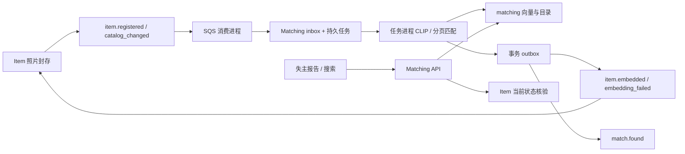

# UC3：失物报告、跨场馆检索与向量处理

状态：已实现本地后端，实施目录为 `services/matching-service`。本章修订原计划中 Matching/Embedding 的具体落地边界；事实与验证命令见 [UC3 执行记录](../uc3-implementation.md)。UC4 邮件发送、Claim 和云部署不在本章完成范围。

## 1. 边界与数据所有权

Matching 拥有失主报告、公开目录副本、物品向量、匹配结果及自己的 inbox/outbox/任务表。Embedding 是独立进程运行的计算能力，与 Matching 使用同一个受限领域 schema；不另建可被 Matching 越权读取的 embedding schema，也不直接写 Item。

这一决定将向量写入与后续任务提交放在同一事务，避免依赖“item.embedded 已到达，但向量还未落库”的跨服务竞态。后续如拆成独立 Embedding 服务，须先定义向量写入 API 或不可变向量引用契约，不能通过跨 schema ORM 替代。

没有跨服务表外键、其他 schema 查询权或数据库 BYPASSRLS。三个运行身份：

| 身份 | 可访问范围 |
| --- | --- |
| API | 自己的报告、匹配与幂等记录；available 公开目录及对应向量；仅写自己的任务、审计、outbox |
| internal | 按可信 match ID 查询最小通知上下文；不能查询报告原文或向量，不能批量枚举匹配 |
| worker | 本 schema 的索引与任务；为后台匹配读取开放报告；不访问 Item schema |

迁移身份单独配置。所有业务表 FORCE RLS；用户上下文使用事务内 `app.user_sub`，不从 body 接收 owner_id。内部会话设置已鉴权路径中的 `app.resource_id`。连接复用时上下文不会保留。

## 2. 报告与搜索契约

失主必须有已验证 access token、`owner` 角色和允许的用户客户端，不要求场馆租户 claim。场馆员工身份本身不能读取其他失主报告。

| 接口 | 规则 |
| --- | --- |
| POST /v1/lost-reports | description 必填；可附 photo_base64、category、venue_id、found_from、found_until；返回 201 和 ETag |
| GET /v1/lost-reports | 只分页列出自己报告，包括 open/closed |
| GET /v1/lost-reports/{id} | 不可见和不存在均为 404 |
| POST /v1/lost-reports/{id}/close | 幂等 key + If-Match；关闭报告并使其匹配失效 |
| GET /v1/lost-reports/{id}/matches | 只展示当前仍可用的匹配；关闭报告返回空列表 |
| POST /v1/search | text/photo_base64 至少一个，均存在时融合；跨场馆检索 |

搜索与报告的日期字段是“拾得时间”的闭区间，不是失主提交时间；`venue_id` 是搜索过滤条件，不用于改变用户的授权租户。报告保存一次性描述与向量；本轮不提供报告编辑或重新开启，修改搜索条件可新建报告并关闭旧报告。

创建与关闭要求长度 8—128 的可打印 ASCII Idempotency-Key，作用域包含客户端、sub、动作及资源。相同 key 与摘要重放原结果；不同摘要 409。快照保存 24 小时，不保存查询照片。创建成功后模型暂时故障仍可重放成功响应。关闭先校验可见性，再重放幂等，首次执行才比较 ETag；缺失 428、旧版本 412。

推理在数据库事务外执行；首次并发同 key 可能重复计算，但报告、审计、任务、事件和幂等记录只提交一次。并发调用在事务锁冲突时可得到 409，随后用原 key 重试。

输入只接受 raw base64，拒绝 data URL。查询图像不超过 5 MiB，仅单帧 JPEG/PNG/WebP、最多 1600 万像素；JSON 总体 8 MiB，分块传输也限流。Item 已封存的工作照片仍沿用 UC2 的 10 MiB 上限，解码像素限制相同。查询照片不写入 S3，不在响应、日志或事件中保留；报告仅存 has_photo 和受 RLS 保护的 embedding。

## 3. 模型与检索语义

真实 OpenCLIP ViT-B/32，固定 512 维，OpenAI QuickGELU 架构。单模态先归一化，双模态等权求和后再归一化；登记物品使用公开 description 与封存照片，失主查询使用所提供模态。

所有 API/任务副本必须配置同一份可信本地 checkpoint 及完整 SHA256。启动后的推理不下载权重；缺依赖、缺文件、摘要错误均保持模型未就绪，搜索/报告编码返回 503，不提供随机向量或关键词回退。模型版本含 checkpoint 摘要前缀，查询只与同版本向量比较。

CLIP 原版文本上下文 77 token，长描述被 tokenizer 截断。原版模型以英语为主；本轮真实测试不证明中文或多语种找回质量。后续若切换多语种模型，必须保留同一模型空间、重新索引、标定阈值并更新模型版本，不可混用不同空间的向量。

数据库使用 vector(512) 和 HNSW cosine 索引，筛选类别、场馆、拾得时间与 available 状态。检索使用余弦相似度，分值范围 -1 到 1，不能在前端标成“概率”或“置信百分比”。自动匹配默认阈值 0.25，仅为可配置初值，正式演示前用实际物品样本标定。

单次候选上限默认 100，响应明确给出 candidate_limit 和 potentially_truncated。候选不足可能来自近似召回、过滤或实时 Item 核验；不保证全库精确排名。跨场馆仍只读取公开字段，不能将核验答案或联系方式拼入 CLIP 文本。

返回每个候选前在事务外读取 Item 的 `items.index` 上下文，验证当前 available、tenant、item_version 和 processing_correlation_id 一致。数据库副本即使尚未收到撤销/预留事件，也不会继续展示该物品；依赖失败返回 503。此检查是响应时快照，真正认领仍须由 Claim 重新核验与预留。

响应只含 item_id、tenant_id、内容版本、标题、描述、分类、拾得时间、公开位置、短期照片 URL、score，不含 S3 key、核验问题参考答案或内部任务载荷。搜索是有界 top-k 请求，无 offset；报告与匹配列表使用原通用分页约定。匹配列表先分页再做实时过滤，因此可能出现短页，has_more 仍指数据库页是否有后继。

## 4. Item 事件链与乱序防护

1. 消费 `item.registered`，在同一事务写 inbox receipt 与 embed 任务后才删除 SQS 消息。event_id 重复时不重复排队，事件 ID 被复用为不同内容时拒绝确认。
2. 任务读取 Item 当前上下文，核对租户、内容版本、原 correlation_id、照片桶/key、description、category；旧轮次、撤销或内容不一致时记 superseded。
3. 工作负载使用只读 IAM 从 allowlist 桶读取封存对象。事件不是任意 URL 抓取入口；模型计算与 S3/RPC 均不持有 SQL 事务。
4. 推理后再次核验 Item 当前轮次；用任务租约 token 完成事务。向量以 source_revision 单调更新；更旧版本不能覆盖更新结果。
5. 向量写入、item.embedded 发件箱与 item_match 任务原子提交；成功/失败事件原样带回 Item 的 correlation_id 与 item_version。
6. Item 结果消费者决定是否切为 available，并发布新的 catalog_changed；Matching 仅按更高 revision 更新公开目录。

非 available 状态保留 revision 墓碑。catalog.available 和向量完成各自触发匹配，所以任何到达次序都能在双方齐备后继续。相同 item ID 的已知 tenant 不可变。

失主创建报告时也原子排入 report_match 任务，因此已有物品和后到物品两种顺序均可工作。单个 report_match 检索有界候选；item_match 以 UUID 顺序每页扫描最多 50 个开放报告，提交游标后释放租约。关闭报告与保存匹配共用报告行锁，关闭后不会被后台重新激活。

每个 report/item 对仅一条匹配，首次建立时写 match.found；重复触发不会重复制造通知事件。物品同一 ID 的后续内容版本可更新匹配版本和得分，但不会再次发送首次匹配事件。后台允许按最终一致目录建立候选，所有展示与通知入口再次核验 Item。

## 5. 消息、失败与运维

consume、tasks、outbox 是不同进程。任务/事件使用 SKIP LOCKED、300 秒租约和完成 token；外部调用在锁外；失败指数退避加抖动，最多十次。发送成功后进程退出可能产生相同 event_id 的重复发布，接收方仍需 inbox 去重。

坏图片立即写 item.embedding_failed；依赖/模型故障退避，耗尽后写 retry_exhausted。终止失败与失败事件同事务提交。Item 依据原关联 ID 拒绝过期失败结果。

终止的 embedding 任务不允许直接手动重放：必须走 Item 现有 retry-embedding 接口，生成新 correlation_id。其他失败任务/outbox 可通过 worker CLI 的 --retry-id 和 --operator 重放并写审计；操作身份来自受限 worker 数据库凭据，operator 参数只是归因。

部署需配置：

- Matching 输入队列过滤 item.registered、item.catalog_changed；Item 结果队列过滤 item.embedded、item.embedding_failed。Notification 后续订阅 match.found。
- 队列 DLQ、SNS SourceArn 策略、发布/接收 IAM、sealed 前缀只读授权；不能让普通用户向主题发布事件。
- API/internal/worker 三类数据库 secret，迁移凭据不进入运行容器；model 路径只读挂载。
- 监测 pending/failed 工作、发件箱延迟、消费 DLQ、任务进程存活；本轮 HTTP 指标不替代任务积压告警。
- consume 在持久入队后确认 SQS，故 tasks 的积压位于 PostgreSQL。tasks 至少保留一个副本或按数据库积压伸缩；不能仅以 SQS 深度将其缩到零。原 ADR-0002 中单独 SQS 深度扩缩容需据此调整。

默认轻量镜像不安装 ML，适用于 consume/outbox 和健康探针；API/任务推理镜像必须用 INSTALL_ML=true，并挂载权重。ML 依赖单独 universal lock，避免让所有业务服务安装 PyTorch；该锁的 Linux 依赖包含 CUDA，CPU 镜像优化须独立验证 CPU wheel。

## 6. UC4 对接与后续 Agent 工作

已提供 `GET /internal/v1/matches/{match_id}/notification-context`。只允许 Notification 专用客户端和 lostlink/matches.notify；返回 ID、active、item_title、venue_name，不提供失主联系方式。Item 状态改变、报告关闭、版本/轮次不一致时 active=false；依赖不可用返回 503。

相对于 06 文档的初稿，明确 `venue_name` 当前可为 null。现有 Venue 没有可供机器使用的公开目录；不能伪造场馆名称，也不能跨 schema 读取。Notification 首版使用通用“场馆”标签或省略名称，未来增加经过授权的 Venue 目录后再填充；tenant_id 已足够标识归属。Notification 必须在发送前核对所有 ID 与事件一致，并实时获取已验证收件邮箱。

以下工作保持后续任务状态：

- UC4：Notification inbox、身份邮箱解析、SES、发送去重与真实收件验收；本轮没有发信。
- Claim：根据搜索结果重新取得 items.context 并走预留流程，不能相信旧的搜索状态。
- 部署：真实 Cognito M2M、网关、RDS 扩展/IAM、EKS/KEDA、告警与备份验证。
- 质量：实际失物数据集上的跨模态/多语言效果、阈值与召回率；5,000 张照片吞吐和端到端时延。
- 生命周期：报告保留期、删除/清理任务与索引重建命令。当前关闭报告立即停止匹配，但保留私人记录；inbox/墓碑不自动清理，防止无约定的旧事件重入。

接手者应先读本章与 UC3 执行记录，再运行当前测试；不要重复创建第二套 CLIP/Matching 存储，不要把本地替身身份验证写成云端已联调。
