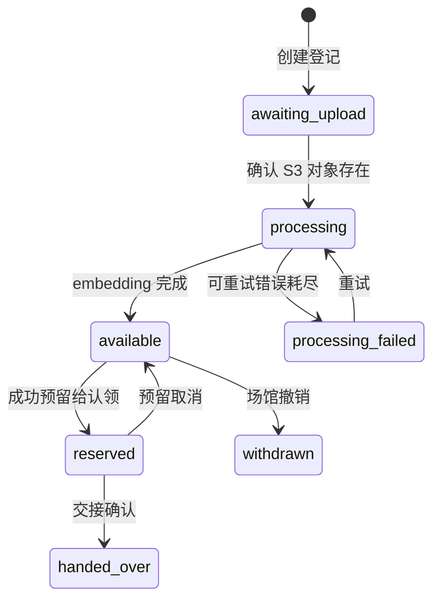

# Jiang Yibai 后端后续实施计划

更新时间：2026-10-20。基于 proposal、一期计划与[后端基础设计](backend-foundation.md)。

后续实施已整理为[Agent 移交文档](backend-handoff/README.md)，包含 T0—T6 任务拆分、接口、数据模型、失败恢复和验收要求。本文保留总体路线；具体实施以移交文档中的完整状态机和契约为准。文档完成不表示业务服务已经实现。

## 当前阶段

UC1/Venue 与 UC2/Item 已完成服务实现及本地验证，见 [UC1 记录](uc1-implementation.md)和 [UC2 记录](uc2-implementation.md)。Item 已验证实际 Venue 权限调用、S3/SNS/SQS 流程及 5,000 条分批登记。下一步可以推进 Claim，同时补齐所需通用 T0；云端与实际 CLIP/Matching 联调继续由接入记录跟踪。

2026-10-20 更新：UC3 Matching/Embedding 已实现（见 [UC3 记录](uc3-implementation.md)）；Claim 所需的通用 T0 已补齐，见[移交文档 01 第 8 节](backend-handoff/01-contracts-and-access.md)；UC5 Claim 与 UC4 Notification 已实现，见 [UC5 记录](uc5-implementation.md)和 [UC4 记录](uc4-implementation.md)。下一步为 T6 联合验收与部署交接，T5 Partner 属于第二阶段。

本轮交付 B1 的公共基础设施：共享库、服务模板、鉴权、租户会话、事件传输、日志指标、模板迁移及测试。B1 中“所有业务服务使用共享库”和“业务数据模型及迁移”需要随各业务服务完成，不能因模板已完成就把整个 B1 标记为全部完成。

## 1. Venue Service

先创建场馆、成员关系和角色管理的数据模型及 API。一个场馆对应一个租户。首期员工每次只使用一个活动场馆身份，管理员只能管理本场馆员工。

新场馆入驻由具备 `platform_admin` 角色的运营身份执行；首次管理员通过部署引导流程建立，避免公开自助接口直接赋予管理权限。后续可增加申请与审核流程。普通员工身份的租户 claim 由可信成员关系生成。

验收：两个场馆可分别管理自己的成员；伪造请求租户、越权修改角色、跨场馆读取均被拒绝；API 文档与迁移齐全。

## 2. Item Service 与可靠事件

实现登记、详情、列表、修改、撤销、照片上传及批量导入。公开字段与隐藏核验信息分开建模。

建议状态：

照片的对象 key 由服务端生成并绑定场馆与物品；确认上传时验证对象存在及基本元数据。保存公开描述快照与 S3 引用后，通过事务发件箱产生 `item.registered`。事件重投复用 ID。worker 处理完成产生带 `item_version` 的 `item.embedded`，旧版本结果被忽略。

同时建立发件箱投递器、重试状态及消费者去重能力。共享 SNS/SQS 发布器作为投递器的传输层。批量导入以任务和逐项结果处理，避免一个大事务覆盖 5,000 张图片。

验收：照片未上传时不会提前触发 worker；事件发布失败不丢任务；重复确认不重复创建逻辑事件；匹配系统不可用时仍能接受登记；不同场馆的物品和对象不可越权修改。

## 3. Claim Service

实现提交认领、核验问题、审批、拒绝及交接。问题可向认领者展示，答案与场馆记录的隐藏细节不会在公共响应中返回。

认领状态采用 `submitted → approved/rejected → handed_over`，另提供可审计的取消操作。为防止同一物品被不同认领同时批准，审批先通过 Item Service 的内部幂等接口，以 `claim_id` 原子预留物品；已有其他预留时返回冲突。Claim Service 持久化审批流程进度，对中断进行重试或补偿，避免跨服务直接写表或依赖分布式数据库事务。

QR 交接码使用高熵随机值，数据库保存摘要、有效期及使用状态。仅获批认领可以签发；所属场馆扫码确认时原子消费，重复扫码不会重复交接。交接事件与物品状态同步也使用可重试流程。

审批前场馆不能读取失主联系方式；审批后只按该认领授权披露交接所需字段。关键操作写入审计记录。

验收：并发审批同一物品只有一个有效认领；重复请求可安全重试；无权限场馆不能审批或交接；过期和已使用 QR 被拒绝。

## 4. Notification Service

消费 `match.found`，按可信失主标识取得通知目标，通过 SES 发送邮件。保存通知任务及发送结果；消息处理提交后确认 SQS。失败使用有限重试并进入死信流程。

业务幂等键以匹配 ID、接收人和通知渠道组合，避免一次匹配重复生成发送任务。外部邮件发送与数据库不能原子提交，因此不能承诺严格一次送达；需要记录发送状态、提供失败恢复，并在报告中说明发送成功但确认失败的重复邮件窗口。

验收：正常匹配可送达，重复事件不会重复生成任务，失败可追踪与重试。真实 SES 联调依赖云端配置；LocalStack 的 S3/SQS/SNS 测试不代表邮件已验证。

## 5. Partner API 与 Webhooks

在既有服务上开放经过 scope 限制的合作方接口，不先增加独立微服务。合作方只能访问被明确授权的交付数据。

Webhook 由 Notification Service 投递，使用 HMAC、时间戳及事件 ID；记录投递状态并进行有限重试。订阅地址需要限定合法 HTTPS 目标，避免被用于访问内部服务。Seed 2 通过平台 API 和事件实现，不直接读取其他服务的数据库表。

验收：模拟快递合作方可完成授权查询和事件接收；签名可验证；无权合作方无法读数据；投递失败可追踪。

## 每阶段完成条件

1. 数据模型、迁移、API 和事件定义一起交付。
2. 完成正常流程、权限边界、重复操作及失败恢复的必要测试。
3. 更新中文业务设计和协作清单，提供可运行示例与复查说明。
4. 对应镜像可构建，本地联调通过后再进入 AWS 联调。
5. 记录实际工作量；当前分支不自动提交，交由 Jiang 手动复查及 commit。

原 proposal 与一期计划的日程存在差异，本文件给出实施顺序及验收标准，不声称原计划中的过往截止项已经完成。
