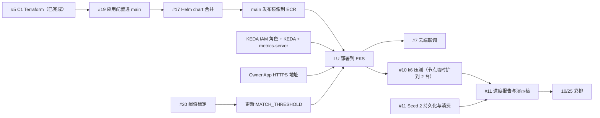

# Phase 2 计划：上云、扩容演示与 Seed 2（2026-10-22 至 10-26）

维护人：YANG DONGWEI。更新时间：2026-10-22。任务以 GitHub issue #5–#11 为准，本文是汇总视图，记录依赖、关键路径和 Seed 1/Seed 2 工时对比。

**目标：** 10/26（周一）9:00–9:40 演示时，Seed 1（UC1–UC5）在 AWS dev 上端到端可用；能展示 API 按 CPU 扩容和 embedding 按积压（KEDA）扩容；Seed 2 能演示一次快递取件的状态流转；进度报告和演示稿完成。10/25 全员彩排。

> 10/23 主线状态补充：下表保留 10/22 的计划快照。#20 的标定工作流、#22 阈值、#23 Delivery 持久化和 #24 C3 已纳入本轮主线；当前部署方式、验收缺口和代码来源限制见 [main 进度核对](main-progress-2026-10-23.md)。

## 任务与状态

| Issue | 内容 | 负责人 | 截止 | 状态（10/22） |
| --- | --- | --- | --- | --- |
| #5 C1 | Terraform：VPC、EKS、RDS+pgvector、ECR、S3、SNS/SQS、Cognito、预算告警 | LU JINGXING | 10/22 | 已在 AWS apply 并验证（见 `infra/terraform/README.md`），#13 已合入 main。应用层配置（18 个进程 IAM 角色、Secrets Manager、域事件 topic 与 3 个过滤队列、Cognito 触发器）在 #15，经 #19 合入 main |
| #6 C3 | Helm 部署、HPA/KEDA、Ingress、监控 | LU JINGXING + YANG DONGWEI | 10/23 | chart 在 #17（CI 全绿，待 review）。部署前需：KEDA operator IAM 角色、安装 KEDA 与 metrics-server、Owner App HTTPS 地址。Grafana 未开始 |
| #7 B | Cognito/SES 云端联调，架构审阅跟进 | JIANG YIBAI | 联调 10/23，修复 10/24 | #14（契约与错误体）、#18（Cognito 触发器、部署验证）待合并，目前与 main 有冲突 |
| #8 D | 前端补齐 UC5/UC1/UC4 | ZHANG JI | 10/22 | 已随 #16 合入 main，待云端验证 |
| #9 D/A | 阈值标定 | ZHANG JI + YANG DONGWEI | 10/23 | 102 对标注数据已随 #16 合入；标定工作流在 #20；按结果另提 PR 更新 `MATCH_THRESHOLD` |
| #10 D | k6 压测与扩容演示 | ZHANG JI | 10/24 | 脚本已随 #16 合入；等 dev 部署后实跑 |
| #11 A | Seed 2 最小演示、工时对比、进度报告、演示稿 | YANG DONGWEI | 10/24–10/25 | delivery-service 骨架已合入（#4）；持久化、`claim.*` 消费、报告与演示稿未开始 |

## 依赖与关键路径

关键路径是 **#19/#17 合并 → 镜像发布 → EKS 部署 → 压测**。部署最晚 10/23 晚上完成，否则压测和报告数据都会推迟。

## 每日节奏

- 每晚 10 点站会 10 分钟：完成了什么、下一步、卡在哪。
- PR 需要 1 个 approve，作者不能自批；合并前确认 CI 全绿且与 main 无冲突。叠在其他分支上的 PR（如 #15）合并后要确认改动进了 main。

## 兜底方案

如果 10/23 晚上 EKS 部署仍未跑通：演示改用 docker compose 本地全链路 + k6 压测；扩容部分用 Helm chart、KEDA 配置和架构图讲清设计，并展示 CI 中 `helm-chart` 作业的校验结果。

## Seed 1 / Seed 2 工时对比

用于报告中"平台复用"的论证。只记录实际投入，按人和工作项填写，单位为小时。

| 工作项 | Seed 1（LostLink 核心） | Seed 2（快递交付） | 复用的平台能力 |
| --- | --- | --- | --- |
| 领域模型与状态机 | 待填 | 待填 | — |
| 认证与租户隔离 | 待填 | 待填 | `libs` 的 Cognito 令牌校验、RLS |
| 持久化与迁移 | 待填 | 待填 | `libs/db`、Alembic 模板、受限数据库角色 |
| 事件发布与消费 | 待填 | 待填 | 事务发件箱/收件箱、SNS 过滤队列、DLQ（ADR-0008） |
| CI 与镜像 | 待填 | 待填 | 统一 Dockerfile 模式、CI 自动发现服务 |
| 部署 | 待填 | 待填 | Helm chart 中新增一个 `services.<name>` 条目 |
| 合计 | 待填 | 待填 | |

## 演示前检查（10/25 彩排时逐项确认）

- [ ] Venue Portal 与 Owner App 在 dev URL 跑通 UC1–UC5
- [ ] 搜索 p95 与 HPA 扩容截图（k6 `search`）
- [ ] 批量导入时 matching `tasks` 由 KEDA 扩容的截图（k6 bulk import）
- [ ] 阈值标定结果写入报告 Performance 一节
- [ ] Seed 2：一次 courier 取件的状态流转
- [ ] 演示稿 40 分钟内讲完，含 Demo
