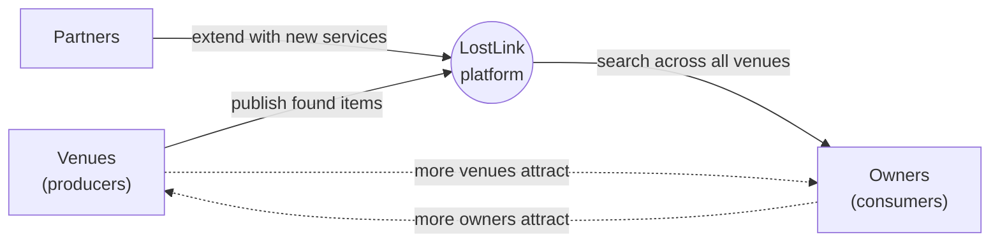
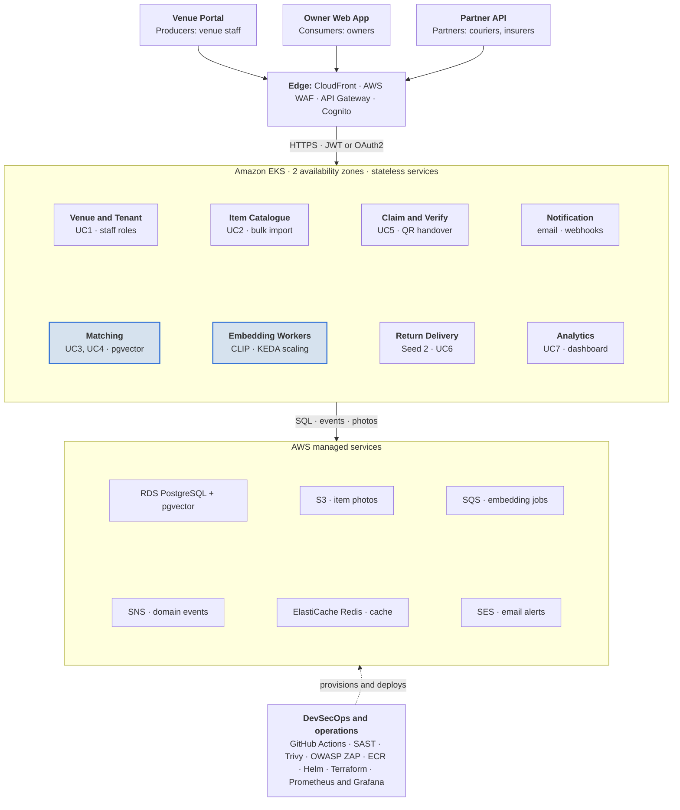
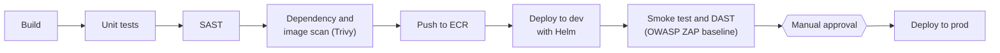
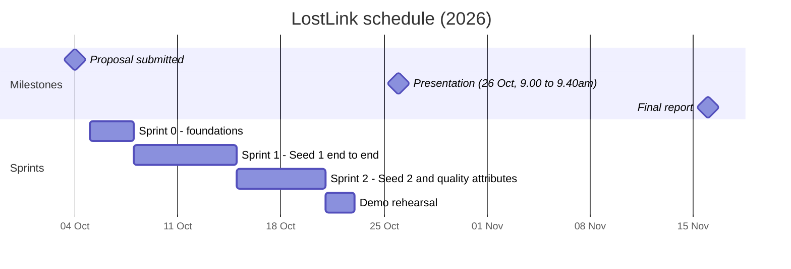

# LostLink — Cross-Venue AI Lost & Found Platform

> Project Proposal · Architecting Scalable Systems Practice Module (SE34FT) · Team 12 · 4 Oct 2026

## Project Information

### Overview

LostLink connects the separate lost-and-found counters of Singapore's malls, MRT stations, campuses and event venues into one shared platform. Owners describe or photograph what they lost once, and AI matching searches every participating venue.

| Item | Details |
|---|---|
| Project title | LostLink: a cross-venue, AI-assisted lost-and-found platform |
| Project sponsor | Not applicable (self-initiated project) |
| Team | Team 12 (4 members) |

| Member | Role | Main responsibilities |
|---|---|---|
| YANG DONGWEI | Solution Architect and AI Matching Lead | Domain analysis and architecture decisions; Embedding Worker and Matching Service; Seed 2 (Return Delivery) |
| JIANG YIBAI | Platform Backend Lead | Shared platform libraries; Venue, Item, Claim and Notification services; Partner API |
| LU JINGXING | Cloud and DevSecOps Lead | Terraform IaC on AWS; EKS, autoscaling (HPA and KEDA); CI/CD with security scanning; observability |
| ZHANG JI | Frontend and Quality Lead | Venue Portal and Owner Web App; analytics dashboard; end-to-end and k6 performance tests |

### Business problem

- **For owners:** lost property is handled venue by venue. An owner who does not know where an item was dropped must call or visit each venue, and many items are never reunited with their owners.
- **For venues:** staff log items in paper books or spreadsheets, answer many enquiries by phone, and store and dispose of unclaimed items at their own cost.
- **For the ecosystem:** existing lost-and-found software is usually bought by a single operator, such as one airport or one hotel chain. Items do not cross venue boundaries, and outside parties cannot build services on top.

### Platform opportunity

LostLink is a multi-sided platform rather than a single application.

- **Venues (producers)** publish found items through a portal or an API.
- **Owners (consumers)** search across all venues at once.
- **Partners** extend the platform with new services, such as return delivery, insurance claims or event organisers' lost-property desks.

Each new venue makes the platform more useful to owners, and more owners make it more attractive for venues and partners to join.

## General Architecture

LostLink is a set of stateless microservices on Amazon EKS, one per bounded context, behind a shared edge layer. The AI matching core is shared by every venue and every seed.

**Every venue and partner shares one AI matching core on AWS**
*(LostLink logical architecture on AWS · 3 client channels, 8 services, 6 managed services)*

> The highlighted services (Matching, Embedding Workers) form the shared AI matching core.

Requests from all three channels pass through one authenticated edge. Photo embedding runs asynchronously through SQS, so heavy AI work scales separately from the user-facing APIs.

### Initial architecture decisions (to be refined in the report)

| # | Decision | Rationale / trade-off |
|---|---|---|
| 1 | One microservice per bounded context | Each team member owns a service and seeds can be added without changing the core. |
| 2 | Asynchronous embedding through SQS and KEDA | A burst of uploads queues up instead of slowing searches. |
| 3 | pgvector inside RDS PostgreSQL rather than a separate vector database | One store, transactional consistency, lower cost. The trade-off is a lower search ceiling than a dedicated vector engine. |
| 4 | Domain events on SNS with webhooks to partners | New partners subscribe to events without changes to the core services. |
| 5 | Shared-schema multi-tenancy with a tenant ID and row-level security per venue | Keeps onboarding cheap while isolating each venue's data. |

These decisions are refined in the [architecture decision records](./adr/).

## Scope of Work

We will build the shared platform core and two seeds on top of it. The second seed proves that new services built on the platform need much less effort than building from scratch.

### Platform components

| Component | Description |
|---|---|
| Seed 1: Found-item matching | Venues register found items. Owners search across all venues by text or photo and claim their items. |
| Seed 2: Return delivery | A partner courier collects a claimed item and delivers it to the owner. Built only on platform APIs and events. |
| Future seeds (roadmap only) | Event and concert lost-property desks, hotels, lost pets |
| Producers | Venues, through the Venue Portal or the bulk-import API; partners offering services such as delivery |
| Consumers | Owners, through the Owner Web App; partners consuming item and claim events through webhooks |
| Shared platform services | Identity and tenancy, Item Catalogue, Media and Embedding pipeline, Matching, Claim and Verification, Notification, Partner API and webhooks, Analytics |

### Use cases in scope

| ID | Use case | Description |
|---|---|---|
| UC1 | Venue onboarding | A venue registers as a tenant and manages its staff accounts and roles. |
| UC2 | Register found item | Staff upload a photo and description, one at a time or by bulk import. |
| UC3 | Report and search | An owner reports a lost item and searches all venues by text or photo. |
| UC4 | Automatic match alert | When a new found item matches an open lost report, the owner is notified. |
| UC5 | Claim and verify | The owner answers verification questions about hidden details. The venue approves, and a QR code is issued for handover. |
| UC6 | Return delivery (Seed 2) | The owner requests delivery, and a partner courier picks up and delivers the item. |
| UC7 | Venue analytics | A dashboard shows item volume, recovery rate and loss hotspots. |

**Out of scope:** real payments (the delivery fee is mocked), native mobile apps, integration with real courier or venue systems (simulated partners instead), police reporting and multi-language support.

### How we will demonstrate the course requirements

| Area | What we will build and demonstrate |
|---|---|
| Scalability | Bulk-import 5,000 found-item photos to simulate the day after a large event. The SQS backlog makes KEDA scale the Embedding Workers out and back in. A k6 search load test makes HPA scale the API pods. Grafana shows queue depth, pod count and p95 latency. |
| Availability | EKS nodes and RDS are spread across two availability zones. We will delete a pod during the demo with no user-visible failure. Queues decouple uploads from matching, so venues can keep registering items if matching is down. |
| Cloud native | Stateless containerised services on Amazon EKS. Managed services: RDS PostgreSQL with pgvector, S3, SQS, SNS, ElastiCache, Cognito and SES. All infrastructure in Terraform. |
| DevSecOps | GitHub Actions pipeline (see diagram below). Terraform plan runs on every pull request. |
| Security | Cognito login for owners and staff; OAuth2 client credentials for partners. Role-based access per venue tenant. AWS WAF and rate limits on search to stop item fishing. Ownership verification before handover. Owner contact details hidden from venues until a claim is approved. Encryption in transit and at rest; presigned S3 URLs for photos. |
| Platform engineering | Domain-driven bounded contexts. API-first with OpenAPI contracts. Shared libraries for auth, event schemas and observability. A service template (golden path) for new services. Partner documentation and webhooks. We will record the effort for Seed 2 and compare it with Seed 1 to show the benefit of reuse. |
| Analytics | Item and claim events are stored in S3 and summarised in the venue dashboard (UC7). |

**DevSecOps pipeline (GitHub Actions):**

## Effort Estimates

The estimated total effort is **40 man-days**: 10 man-days for each of the 4 members, which matches the module guideline. Each member owns one workstream end to end. Integration, reports and the presentation are shared.

| WBS | Task | Owner | Effort (man-days) |
|---|---|---|---:|
| 1.1 | Domain analysis, bounded contexts, OpenAPI contracts | YANG DONGWEI | 1.5 |
| 1.2 | Logical and physical architecture, architecture decisions | YANG DONGWEI | 1.0 |
| 2.1 | Terraform: VPC, EKS, RDS, S3, SQS, ElastiCache, Cognito | LU JINGXING | 3.0 |
| 2.2 | CI pipeline: build, unit tests, SAST, Trivy scans | LU JINGXING | 2.0 |
| 2.3 | CD pipeline: Helm, dev and prod environments, approval gate, smoke and ZAP tests | LU JINGXING | 2.0 |
| 2.4 | Observability and autoscaling: Prometheus, Grafana, HPA, KEDA | LU JINGXING | 1.5 |
| 3.1 | Shared libraries and service template | JIANG YIBAI | 1.5 |
| 3.2 | Venue and Tenant Service (UC1) | JIANG YIBAI | 1.5 |
| 3.3 | Item Service with photo upload and bulk import (UC2) | JIANG YIBAI | 2.0 |
| 3.4 | Claim and Verification Service (UC5) | JIANG YIBAI | 2.0 |
| 3.5 | Notification Service and partner webhooks | JIANG YIBAI | 1.5 |
| 4.1 | Embedding Worker: CLIP model, SQS consumer | YANG DONGWEI | 2.0 |
| 4.2 | Matching Service: pgvector search, ranking, match alerts (UC3, UC4) | YANG DONGWEI | 2.5 |
| 4.3 | Seed 2 Return Delivery with a simulated courier partner (UC6) | YANG DONGWEI | 1.5 |
| 5.1 | Venue Portal (React) | ZHANG JI | 2.5 |
| 5.2 | Owner Web App | ZHANG JI | 2.5 |
| 5.3 | Analytics dashboard (UC7) | ZHANG JI | 1.0 |
| 5.4 | Test data (5,000 photos), end-to-end and k6 load tests | ZHANG JI | 2.5 |
| 6.1 | Integration testing and bug fixing | All (0.5 each) | 2.0 |
| 6.2 | Progress reports, presentation and final report | All (1.0 each) | 4.0 |
| | **Total** | | **40.0** |

## Schedule

| Dates | Milestone | Exit criteria |
|---|---|---|
| 4 Oct | Proposal submitted | Team formed in Canvas, proposal uploaded |
| 5 to 7 Oct | Sprint 0: foundations | Repository, service template, Terraform skeleton and CI skeleton ready; review comments addressed |
| 8 to 14 Oct | Sprint 1: Seed 1 end to end | UC1 to UC5 running on the dev environment through the pipeline |
| 15 to 20 Oct | Sprint 2: Seed 2 and quality attributes | UC6 and UC7 done; autoscaling and load tests pass; security scans clean |
| 21 to 22 Oct | Demo rehearsal | Slides ready, demo script timed to 40 minutes |
| 26 Oct | Presentation | Team 12 slot: 26 Oct, 9:00 to 9:40am |
| 16 Nov | Final report | Presentation feedback included |

Fortnightly progress reports will be submitted to Canvas throughout.

## Risks and Mitigations

| Risk | Impact | Mitigation |
|---|---|---|
| AWS cost overrun from EKS and RDS | Budget exhausted before the demo | Smallest instance sizes and Spot nodes for workers; Terraform destroy when the environment is idle; billing alarms |
| Matching accuracy too low for a convincing demo | Weak demo of the core use case | Pre-trained CLIP model combined with filters on category, venue and date; a curated demo dataset |
| Embedding on CPU is slow | Long queue backlog | Batch inference; this backlog is also what triggers the KEDA scale-out we demonstrate |
| Scope creep with 4 members | Unfinished features | Seed 1 is the minimum viable product; Seed 2 and the dashboard are first to be trimmed if Sprint 1 slips |
| Fraudulent claims and misuse of search | Security weakness | Verification questions on hidden details, rate limits, audit log of claims |
