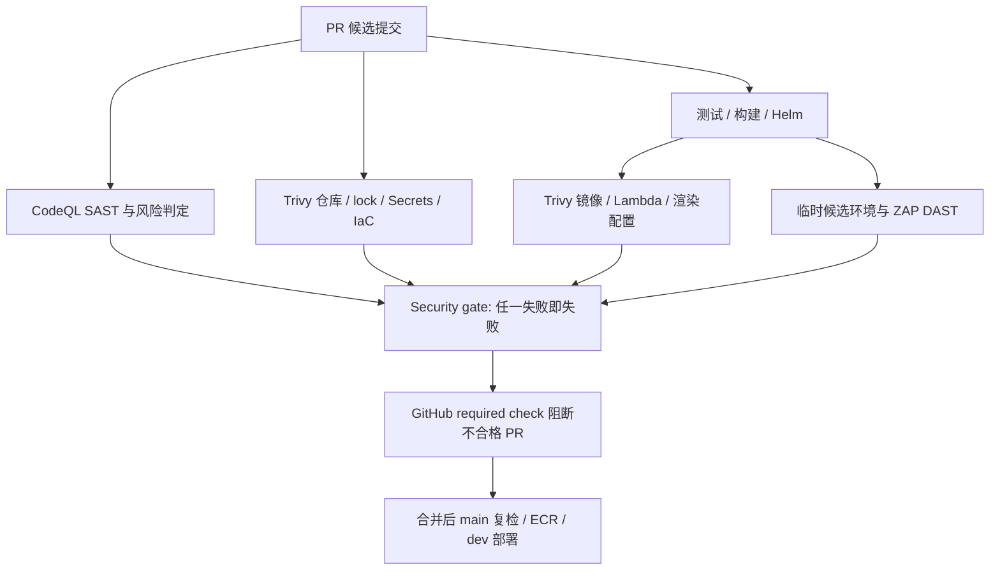

# CI 安全门禁实施计划

更新日期：2026-11-04。初始检查基线：`main` / `f9006121ce56e5e14c48ebff71727b37820b1d64`。

本轮由你独立完成，在 **`codex/ci-security-gates` 同一分支分步 commit，全部完成后统一提交一个 PR**。不安排团队分工，也不按阶段拆多个 PR。

最终验收要求：**SAST、DAST、Trivy 任一质量门禁不合格，PR 必须无法合并**。失败、取消、异常跳过、扫描器错误、缺失报告都不能成为绿色通过；报告上传成功不代表安全通过。

## 1. 已有流程与边界

- `ci.yml` 对 PR、main push 和手动运行执行测试、Ruff、契约、集成测试、Helm 检查和 Trivy；main 额外发布镜像并部署 dev。PR 不向共享 dev 发布。
- 已有 7 个后端镜像和 frontend 镜像的扫描。部署目标是 Venue、Item、Matching、Claim、Notification 和 frontend；Delivery / service-template 不在现有 dev 自动部署范围。
- Cognito Linux ZIP 已有构建、集成测试和 Trivy。本轮第一步将它接入 CI 的复用工作流和安全汇总依赖，不再由独立 PR 触发造成门禁遗漏。
- 部署脚本会等待 rollout，执行 HTTPS / 未认证 API / 私有路由 smoke；脚本内部失败会回滚。它不是 DAST，后续独立扫描步骤的失败也不会自动触发这段回滚。
- Terraform workflow 运行 fmt、validate 和 mock-provider test，没有自动 plan/apply。现有基础设施、数据库迁移、OIDC / RBAC 变更仍按实际所需操作。
- 当前仓库为 public，适合 CodeQL；GitHub 连接具备 push 权限但没有 admin 权限。仓库 Rulesets、已有 CodeQL Default setup、Variables/Secrets 和 AWS 实际状态仍需核验。

## 2. Commit 1：完善 Trivy 覆盖、证据和门禁

实施内容：

1. 保留 Trivy 0.76.0 与固定 Action commit。增加 pip 文件匹配，扫描 `requirements.lock`、`requirements-dev.lock`、Matching ML lock；同时纳入 npm dev dependencies。
2. 对三个 Python / 两个 npm lock 的每个包名与版本做清单校验，避免空扫描或只扫描到部分依赖。镜像要求 OS / Python runtime 清单，Matching 另要求 Torch；Lambda 要求实际依赖。
3. 用与现有部署测试共享的合成输入，渲染五个业务 chart、platform、umbrella 两种配置，并扫描静态 CD RBAC；逐文件检查有扫描结果。原始 Terraform / Dockerfile 继续扫描，Helm 源码继续检查 Secrets。
4. 先采集全量 JSON，再强制执行统一判定：可修复 HIGH/CRITICAL 漏洞、失败的 HIGH/CRITICAL IaC 检查、任何 Secret 命中，以及不完整/异常扫描均使 job 失败。未修复及较低级别漏洞仍留在报告中。
5. 上传按目标区分的脱敏 JSON / 摘要，保留 30 天。删除原始 Secret 匹配、源码片段、任意元数据；原始报告仅留在私有临时目录，最后清除。
6. 新增始终执行的 **`Security gate`**，检查仓库、所有镜像、渲染后 Kubernetes 和 Cognito 扫描均成功。main 发布也等待它，保留扫描后原样转移镜像的链路。
7. 记录原有六处 Terraform 忽略规则的范围和复查日期，不增加大范围忽略。修复本次实际命中的漏洞，不降低阈值。

本次发现 `tinypool` 两个 Critical 漏洞，升级前端测试依赖至受支持的 Vitest 4.1.12 以移除它。Vitest 4 已移除 Tinypool。[官方迁移说明](https://v4.vitest.dev/guide/migration.html)。

验收：运行真实 Trivy 仓库与渲染配置扫描；测试高危/Secret 命中、缺失包清单、缺失报告、错误退出和 skipped/cancelled 不能放行；运行受影响 Python / 前端回归检查。

本地 Docker daemon 当前不可用，真实镜像和 Linux Lambda ZIP 的构建/扫描需要最终 PR 的 GitHub Actions 验证；不得把本地辅助判定测试称作完成了所有镜像扫描。仓库管理员将 `Security gate` 设为 required check 后，第一步的 Trivy 失败才会在 GitHub 上实际禁止合并。

## 3. Commit 2：SAST 进入同一个 PR 门禁

1. 在 CI 内增加 CodeQL Python 与 JavaScript/TypeScript 分析，覆盖后端、共享库、前端源码、构建/部署脚本及 Lambda handler。使用 Advanced setup；若已有 Default setup，先处理冲突。
2. 保存 SARIF，并进行显式的高危风险判定。不能只看 CodeQL 分析任务是否成功：分析完成与扫描结果合格是不同条件。
3. 将 SAST job 接入构建/发布和 `Security gate` 的依赖链；PR 不需要 AWS 身份，不能借助 `pull_request_target` 执行不可信 PR 代码。
4. 用受控测试样例验证高危发现与扫描异常均使门禁失败。最终交付不采用仅告警或观察模式。

手动事项：必要时切换 CodeQL setup / 允许 Action；管理员设置 Code scanning 规则和阈值。公开仓库的 CodeQL 可用范围见 [GitHub 官方说明](https://docs.github.com/en/code-security/concepts/code-scanning/codeql/codeql-code-scanning)。

## 4. Commit 3：对 PR 候选版本运行 DAST

**只在 main 部署后扫描共享 dev，不能证明 PR 候选版本合格，也不能满足 PR 阻断要求。** 因此 PR DAST 必须是本轮基础交付内容。

1. 优先在 GitHub runner 上为本次 PR 构建的镜像启动临时应用栈，使用可丢弃数据库和 LocalStack；如确需云端 preview，应先建立与共享 dev 隔离、按 PR / run 标识的环境。
2. 部署并等待就绪后，运行固定版本 ZAP Baseline / 明确代理请求，对前端和可公开路由的候选 API 做被动检查。测试配置必须与生产明确隔离；不能通过关闭认证来声称通过认证检查。
3. 对 React SPA 配置可验证的浏览器爬取或显式入口，请求清单至少包含 Owner App、Venue Portal 和 Matching 页面；报告记录 PR SHA、实际候选镜像、覆盖 URL 与规则判定。
4. 目标限定为本次临时环境，禁止重定向爬取第三方 Cognito / S3；限制速率与总时长。报告脱敏，finally / `always()` 清理临时栈及数据。
5. 显式制定 FAIL/WARN 规则；扫描器错误、目标不可达、无覆盖或缺报告均失败。ZAP 默认发现全部为 WARN，需要配置门禁，不能 `|| true` 放行。[ZAP Baseline](https://www.zaproxy.org/docs/docker/baseline-scan/)。
6. 将 `dast-pr` 加入 `Security gate.needs`，真实运行于每个 PR；不创建恒绿占位任务，不用共享 dev 的扫描结果替代候选版本结果。

验收：候选环境的已知规则违规会使 PR gate 红色；目标不可达与启动失败也红色；失败仍清理资源。匿名 Baseline 的报告不能宣称已完整覆盖认证 API 或主动漏洞测试。

手动事项：只有采用云端 preview 时才配置其 IAM / 环境；runner 本地临时栈无需长期 AWS key 或对共享 dev 的部署权限。

## 5. Commit 4：认证覆盖及部署后补充检查

1. 在临时栈加入专用测试身份 / OIDC-JWKS fixture，保留签名、issuer、audience/client、角色与租户校验，并验证 Owner、Staff、跨租户负面用例。fixture 只能用于隔离测试环境。
2. 从已生成 OpenAPI 契约派生扫描范围，只包含批准的公网端点，改写 `/api/<service>/v1/*` base URL；保留内部接口不可公开访问的断言，不开放线上 OpenAPI。
3. 如需真实 Cognito 的补充验收，使用专用账号/租户及每次运行新 token；凭据、预签名地址、个人信息与 QR 不进入日志或 artifact。真实环境扫描不能替代 PR fixture 的候选版本门禁。
4. 如启用 ZAP API / Full 主动扫描，仅针对批准的临时数据、端点与方法；API Scan 默认主动攻击，不能把整个契约无筛选地指向共享 dev。[ZAP API Scan](https://www.zaproxy.org/docs/docker/api-scan/)。
5. 可增加 main 部署后 dev Baseline 作为运行环境补充。它与部署共享完整并发锁并标记实际部署 SHA；扫描失败如何回滚需明确实现，现有脚本不会自动处理独立 step 的失败。

手动事项：真实 Cognito 身份/凭据、必要的 callback 配置或主动扫描范围；若沿用已有会产生通知的验收流程，按 runbook 暂停 sender、关闭 fixture 报告并恢复。无需增加 CD 的 Secret/数据库迁移权限。

## 6. 后续 Commit：定期复扫与最终验收

- 定时扫描 main 和已部署 digest，以发现代码不变但漏洞库新增的问题；私有 ECR 拉取使用最小只读 OIDC 身份，不假设现有 push / deploy role 能拉镜像。
- 增加独立 DAST 重试入口，避免重试扫描时重建、重推不可变镜像或再次部署。
- 最终 `Security gate` 必须汇总 **SAST + PR-candidate DAST + 全部 Trivy 目标**；failure、cancelled、异常 skipped 或证据不完整均失败。验证所有分支结果及资源清理。
- 最终统一提交一个 PR。管理员将稳定的 `Security gate` 配置为 main required check，并保留既有测试和审阅要求；CodeQL 可再配置 High or higher 的 Code scanning merge protection。
- 源码可以令检查失败，但不能自动建立分支保护。当前连接没有 admin 权限，最终必须实际核验 GitHub 设置，不能仅凭 workflow 已写好宣称 PR 已被保护。

## 7. 需要你手动处理的项目

| 操作 | 何时需要 |
| --- | --- |
| 配置 main Ruleset / required `Security gate` | 必需；首次检查运行后配置，最终验收时核实 |
| CodeQL Default → Advanced setup、Action 允许策略 | 仅现有设置或组织策略需要时 |
| 审阅高危阈值、原有六处 IaC 例外和首次扫描结果 | 第一/二/三步；不建立团队分工 |
| 专用真实 Cognito 账号、租户、受控凭据 | 增加真实环境认证验收时 |
| 云端 preview、只读 ECR OIDC role、Terraform apply | 选择相应方案时；本地 runner DAST 不强制需要 |
| 主动扫描的可写范围、通知隔离与清理 | 启用主动扫描时 |

当前进度：Trivy 和 CodeQL SAST 已实现；SAST 已接入构建和汇总门禁。后续 commit 完成候选版本 DAST、认证覆盖和定期复扫。
